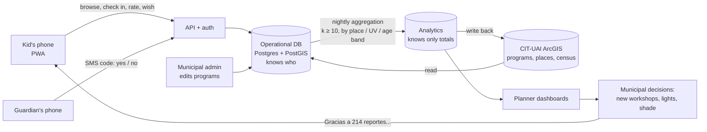

# How Reflejo works: the support system, the UX and the UI

*A guide for learning the project end to end. Each section links to the file with the full
detail and sources. Read this first, then go deeper where you need to.*

---

## 1. The whole thing in one picture

There are two worlds, and the line between them is the most important design decision in
the project:

- **Left of the line, the app knows who you are** (a nickname, your age, your barrio,
  your stickers), because it has to show you your album and remind you of your plans.
- **Right of the line, the city only knows totals** ("41 kids aged 13-17 checked in at Plaza
  Buenaventura in October; 38% of them said it needs lights"). No names, no routes, and no
  number is shown if fewer than 10 kids are behind it.

Everything below is how to build each box and keep that line honest.

---

## 2. Part A: the support system (the part you don't see)

### A1. Client and server

The **client** is what runs on the kid's phone. The **server** is the computer in a data center
that stores everything and answers the phone's requests through an **API** (a list of allowed
questions, like "give me workshops for age 10 near UV 24").

**Recommendation: a PWA** (Progressive Web App): a website that installs like an app, works
offline and updates itself. Why not a native Android app? Because 43% of Lo Espejo
households have a computer but 97% have a phone, most on prepaid data, and many kids share a
parent's phone. A PWA has no store download, weighs a fraction of a native app and runs on
old Android phones. → `02_platform/platform_architecture.md` §1.3

### A2. The database: where the city lives

**PostgreSQL + PostGIS**: a database that understands geography, so it can answer "which UV
is this plaza in?" or "what's within 800 m of this school?" directly.

The main tables (entities):

| Entity | What it holds | Who writes it |
|---|---|---|
| Program | name, type, age range, schedule, how to join, organizer unit | Municipality (via admin) |
| Place | plazas, courts, schools, library, with location | ArcGIS / OSM import |
| Event | concerts, tournaments, dates | Municipality |
| Profile | nickname, age, barrio or school, interests | The kid |
| Guardian link | guardian phone, consent timestamp | The guardian |
| Check-in | who, where, when (operational only) | The kid, by an explicit tap |
| Rating / wish | place, faces, "qué falta" tags, wishes | The kid |

→ `02_platform/platform_architecture.md` §3

### A3. Accounts and consent

- **Kids 14-17** register themselves with a phone number and an SMS code.
- **Kids under 14** (59% of the cohort) need a guardian's verifiable consent (Ley 21.719,
  art. 16 quáter, in force 1 December 2026). The guardian gets an SMS that says exactly what's
  stored and answers SÍ or NO. Until then the kid can browse, but can't check in or rate.
- The app **never** asks for real name, RUT, address or birth date. Nothing in the app needs them.

→ `02_platform/platform_architecture.md` §4.1, §4.4

### A4. Content: who keeps the programs up to date

Today the programs live in the CIT-UAI ArcGIS layer, filled in by 21 program managers from
13 organizations. The app **reads** from it, but three fields are missing for a kid to decide:

| Needed field | Today |
|---|---|
| `dias`, `hora_inicio`, `hora_fin` | Schedule filled in 9 of 108 programs |
| `edad_min`, `edad_max` | Free text ("Niños y niñas de 5 10años") |
| `cupos`, `inscripcion`, `vigente_hasta` | Capacity filled in 7 of 108 |

A simple admin screen for program managers (not direct ArcGIS editing) keeps this current.
**The app is only as good as the schedule field.** → `01_research/04_arcgis_visor.md` §5

### A5. Events: how taps become urban indicators

Each meaningful action is recorded as an **event** with a fixed name, so years of data stay
comparable:

| Event | Becomes this indicator |
|---|---|
| `program_viewed` | Interest per activity type and UV, before anyone commits |
| `checkin_created` | Real use of each place and program, by hour, day and age band |
| `rating_submitted` | Quality and safety perception per place ("luz de noche", "me sentí inseguro/a") |
| `missing_report_filed` (wish) | Unmet demand: what kids want where it doesn't exist |
| `route_viewed` (later) | Desire lines from UV to place, for bike lanes, never a GPS trace |

A nightly job aggregates these into the analytics store and publishes an
`Indicadores_Uso_Espacio_NNA` layer back into the CIT-UAI visor, so planners see it next to
the census and the programs they already use. → `02_platform/platform_architecture.md` §3.3, §1.5

### A6. Privacy techniques, in plain words

| Technique | What it means here |
|---|---|
| Minimization | Don't collect what you don't need (no name, no address, no birth date) |
| Explicit check-in | Location is only recorded when the kid taps "Llegué" at a place, never in the background |
| Place, not person, location | The check-in stores the *place's* UV, not the kid's GPS |
| k-anonymity (k = 10) | No total is published if fewer than 10 kids are behind it |
| Retention | Raw check-ins are deleted after aggregation (e.g. 90 days); totals stay |
| Deletion | "Borrar mis datos" removes the profile; totals already published can't point back to anyone |
| No third parties in the loop | "Cómo llegar" draws the walk on Reflejo's own map instead of opening Google Maps, so no outside company learns where a child is going |
| Guardian view | The adult sees what the child can and can't do and what's stored, approves or revokes, and never sees the child's location |

### A7. Size and cost: it's small

About 11,200 kids aged 8-17 live in Lo Espejo (Censo 2024 blocks). At 40% adoption
that's about 4,500 kids + 2,600 guardians, around 1,100-1,800 daily users and fewer than 5
requests per second (30-60 during a concert-announcement spike). That fits in one managed
Postgres. **Infrastructure costs about US$400-1,500 per year**; the real cost is people:
a content manager, a moderator, a community liaison with the OLN and the schools.
→ `02_platform/platform_architecture.md` §2

### A8. Two things to fix now in the existing data

1. `Beneficiarios_programas` is a **public** layer designed to hold minors' names, RUT and
   birth dates. It's empty today; make it private before anyone fills it.
2. The public programs view exposes program managers' personal emails and phones
   (107 of 108 emails). Show the unit, not the person.

---

## 3. Part B: UX (how it should feel to use)

### B1. The process we followed

1. **Research** in parallel: who the kids are, what science says about attention, which
   apps work, what data exists, what the law requires.
2. **Principles** traced to evidence (each has a paper or pattern behind it).
3. **Flows and screens** from the principles.
4. **Prototype** with real data.
5. **Loop**: render, score against a 10-dimension rubric, fix the top 5, repeat. An
   independent critic agent reviews at the midpoint so the builder doesn't grade itself.

### B2. The UX decisions that matter most

| Decision | Why (evidence) |
|---|---|
| Show 3 real things near you before asking anything | Asking first loses people; Headspace's "value first" pattern |
| The map is home | Pokémon GO and Helsinki's Harrastuspassi: the city is the board |
| Progress only counts when you're really there (QR at the venue) | Pokémon GO raised players' walking by about 25%, some 1,400 steps a day (Althoff et al., 2016), but the effect was back to baseline by week 6 (Howe et al., 2016). Both studies are of adults, so treat them as direction, not dose: the real-world act is what matters, and content needs refreshing every 4-6 weeks |
| 8-12 and 13-17 are different apps in the same app | Peer presence activates adolescents' reward system (Chein et al., 2011): friends matter for teens, not for 10-year-olds |
| Real rewards, no points or leaderboards | Gamification works best through meaning and competence, not points (Sailer & Homner, 2020); rankings of kids are banned |
| Calm: no fake scarcity, no guilt, no infinite feed | Manipulative design is common in kids' apps and more common in apps used by lower-income families (Radesky et al., 2022) |
| Ask "what's missing?" after every visit | This is what turns a kids' app into a planning instrument |

→ `03_design/design_system.md` §1-4, `01_research/02_psychology_papers.md`

### B3. How to test it with real kids (next step)

- **Who:** 5 kids aged 8-12 and 5 aged 13-17 per round (5 users per round find most
  usability problems), recruited through the OLN and one school per pilot UV, with guardian
  consent and the kid's own assent.
- **Tasks:** "Find something to do this afternoon near your school"; "You're at the plaza, get
  the sticker"; "Tell the municipality what this plaza is missing"; "Delete your data".
- **Measure:** task success, time, where they hesitate, and what they say out loud. For
  13-17: "would you show this to a friend?"
- **Then** run a real pilot and measure **visits, not minutes**: check-ins per kid per month,
  share of kids who visit a new place, and wishes that turn into municipal action.

### B4. Where to pilot

| Option | UVs | Argument |
|---|---|---|
| Where the kids are | 37B, 37C, 26 | 59% of the cohort lives in the top 5 UVs (demographics) |
| Where the offer is missing | 24, 36, 29 | 400-900 kids per workshop site; UV 24 has 1,182 kids and no workshop for under-13s (visor analysis) |
| **Recommended** | **24 + 29 (pilot) and 37B (comparison)** | 24 and 29 are both high-population and under-served; 37B has the most kids *and* the most offer, so it shows whether the app adds use where supply exists |

---

## 4. Part C: UI (how it looks)

### C1. What a design system is

A set of **tokens** (named decisions: `--sol: #FFC23D`, `--r-card: 24px`, `--t-med: 240ms`)
plus rules for combining them. Every screen uses the tokens, so changing one value changes
the whole app consistently. In the prototype they're CSS custom properties at the top of
`04_prototype/index.html`. In production they become a Figma library and a component library
with the same names.

### C2. Reflejo's visual system in five decisions

| Decision | Choice | Reason |
|---|---|---|
| Concept | **Muralismo**: flat saturated color, thick ink outlines, hard shadows | Rooted in the community-mural tradition of the south of Santiago; reads as street art to teens and as bright and friendly to kids; survives cheap screens |
| Color | Cream wall by day (8-12), night indigo (13-17); one color per category, always with an icon and a word | Contrast checked: ink on cream 15.5:1; ink on every category color ≥ 6.4:1 (WCAG AA needs 4.5) |
| Type | Bricolage Grotesque (display) + Atkinson Hyperlegible (text) | Atkinson was designed for legibility (distinct I/l/1, 0/O) for early and struggling readers |
| Shape | 2.5px outlines, 18-24px radius, hard 4px shadow that "presses" on tap | Every button feels physical; targets ≥ 48px |
| Character | **Chinco**, the chincol of every Santiago plaza, only in 8-12 mode | Local, not imported; guides and celebrates, never guilt-trips |

### C3. Motion with a job

Motion shows a change of state, not decoration. Pins drop to show the map is alive, the sheet
springs up and keeps the map visible, tabs slide in the direction you move, and "Voy" pops.
The sticker peel is the one big celebration, because it marks something done in the real
world. Everything respects `prefers-reduced-motion`.

---

## 5. What to do next (for the municipality and CIT-UAI)

1. Make `Beneficiarios_programas` private; hide managers' personal contacts in the public view.
2. Add structured schedule, age and capacity fields to the programs layer; fill them for
   the 33 kid-facing workshops first.
3. Add an events layer (concerts, tournaments, fairs) and verify the parks and bike-lane layers.
4. Run 2 rounds of usability tests with 10 kids each (B3), with guardian consent via the OLN.
5. Decide the real rewards with the municipality (priority sign-up, event tickets, a diploma).
6. Print and install QR signs at the pilot places (plazas, courts, schools with Escuelas Abiertas).
7. Build the PWA and the admin (Phase 0-1 of the roadmap), with the privacy line enforced
   in the database, not only in the app.
8. Pilot in UV 24 + 29 with 37B as comparison, for 3 months; publish the first indicator
   layer back into the visor.
9. Refresh content every 4-6 weeks (new workshops, a monthly plaza event), because novelty
   fades (Pokémon GO's walking effect was gone by week 6; Howe et al., 2016).
10. Close the loop in public: tell kids what changed because of their reports.

---

## 6. Glossary

| Term | Meaning |
|---|---|
| API | The list of questions an app can ask a server, and the format of the answers |
| PWA | A website that installs and works like an app, including offline |
| PostGIS | Geography functions inside the PostgreSQL database |
| Event taxonomy | The fixed list of named actions the app records |
| Aggregation | Turning individual records into totals (per place, UV, month, age band) |
| k-anonymity | Only publishing totals made of at least k people (here k = 10) |
| Token (design) | A named design decision (a color, a size, a duration) reused everywhere |
| WCAG AA | The accessibility standard; for text, a contrast ratio of at least 4.5:1 |
| UV | Unidad vecinal, the neighborhood unit the municipality already uses |
| OLN | Oficina Local de la Niñez, the municipal office for children's rights |
