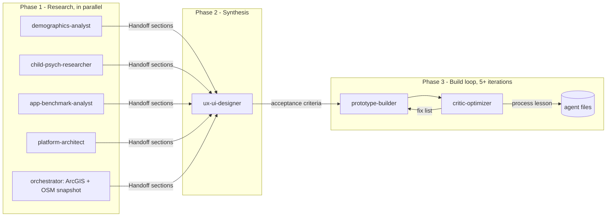

# How the agent system works

Kids App Lo Espejo is built by seven specialist agents and one orchestrator. Each agent has
one question, one output file and one handoff section. The orchestrator (the main Claude Code
session) dispatches them, integrates their outputs and runs the optimization loop.

## The team

| # | Agent | Question it answers | Output |
|---|---|---|---|
| 1 | `demographics-analyst` | Who are the 8-17 year olds of Lo Espejo and where are they? | `01_research/01_demographics.md` |
| 2 | `child-psych-researcher` | What does science say about kids, devices and attention? (5 papers) | `01_research/02_psychology_papers.md` |
| 3 | `app-benchmark-analyst` | Which apps are proven great and why? | `01_research/03_app_benchmark.md` |
| - | orchestrator | What's already in the CIT-UAI visor? | `01_research/04_arcgis_visor.md` |
| 4 | `platform-architect` | What internal system moves the data safely and scales? | `02_platform/platform_architecture.md` |
| 5 | `ux-ui-designer` | What should the app look, feel and behave like? | `03_design/design_system.md` |
| 6 | `prototype-builder` | Build it. | `04_prototype/index.html` |
| 7 | `critic-optimizer` | Is it good? What's the next fix? What should the system learn? | `05_loop/iteration_log.md` |

Role definitions live in `.claude/agents/`. Opening Claude Code inside `Kids App/` makes them
available as subagents by name.

## Flow



## Why it is built this way (efficiency)

- **Parallel where independent, sequential where dependent.** The four research questions
  don't need each other, so they run at the same time. Design needs all of them, so it waits.
- **Handoff contracts.** Every research file ends with a `## Handoff` section. The designer
  reads the handoffs first and the full text only when a handoff is unclear. That keeps the
  context small and the traceability high (every design rule points back to a paper,
  a pattern or a number).
- **One owner per file.** No two agents write the same file, so they can't overwrite each
  other.
- **Data is snapshotted, not re-queried.** `tools/extract_arcgis.py` and `tools/extract_osm.py`
  write `data/raw/`; every agent reads the same snapshot, so numbers are consistent.
- **The critic is independent.** The builder never grades its own work.
- **The loop improves the system, not just the prototype.** Each iteration records one process
  lesson; durable lessons are written back into the agent files (see `05_loop/LOOP.md`).

## Rules every agent follows

1. **Evidence**: every number has a source, year and URL; APA 7 references. Official Chilean
   sources first (INE, MINEDUC, MDSF, SUBTEL, BCN). Never cite a paper that wasn't opened
   and verified.
2. **Children first**: privacy by default, no ads, no open chat with strangers, no public
   rankings of individual kids, no dark patterns, no background location tracking.
3. **Real data**: the prototype uses the real programs and places of Lo Espejo; anything
   simulated is labeled "demo".
4. **Language**: documents in English; everything a kid reads is in Chilean Spanish.

## Running it again

```text
1. python tools/extract_arcgis.py && python tools/extract_osm.py      # refresh data
2. Ask Claude Code (inside Kids App/): "run the research phase"       # agents 1-4 in parallel
3. "run the design phase"                                              # agent 5
4. "run N iterations of the loop"                                      # agents 6 <-> 7
```

---

## How it actually ran (2026-09-28)

| Step | Who | What happened |
|---|---|---|
| Data snapshot | orchestrator | Found the visor's public REST layers (16), snapshotted them, added OSM parks and bike lanes. Found the public `Beneficiarios_programas` schema risk |
| Research | 4 agents in parallel | Benchmark (4 min), psychology (5 min), platform (8 min), demographics (10 min). All wrote a Handoff section |
| Design | orchestrator in the designer role | Wrote `design_system.md` from the handoffs (a cold-start agent would have re-read everything the orchestrator already held) |
| Build + loop | orchestrator as builder; critic as a separate agent at iterations 3 and 5 | 5 iterations, 20-27 screenshots each, `tools/shoot.sh` + `tools/audit.js` |

### Scores across the loop

| Iteration | Scored by | Total | Note |
|---|---|---:|---|
| 1 | orchestrator | 67 | |
| 2 | orchestrator | 78 | Later judged inflated |
| 3 | **independent critic** | **62** | Measured targets and found a broken screen the orchestrator had missed |
| 4 | orchestrator (measured) | 76 | Scored with the DOM audit, calibrated to the critic |
| 5 | **independent critic** | **78** | Stop rule met; five small defects fixed afterwards (post-review patch) |

**The main lesson about the system:** the builder grading itself drifted upward (78) until an
independent critic measured the build (62). Separation between builder and critic, and
measuring before scoring, mattered more than any single design fix.

### Lessons written back into the agents

- `critic-optimizer`: click timeouts are P0; open celebration and error states; the console
  check misses handler exceptions; measure targets/contrast/scroll before scoring.
- `prototype-builder`: isolate third-party stacking contexts and look at the tiles; `<use>`
  needs width/height; never name a variable `L` with Leaflet; don't shadow helpers with locals;
  grep for new identifiers; map visibility checks use the pin body, not its anchor; when a fix
  "doesn't work", check that the patch was saved.
