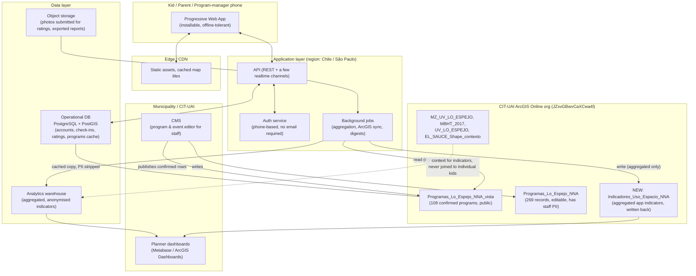
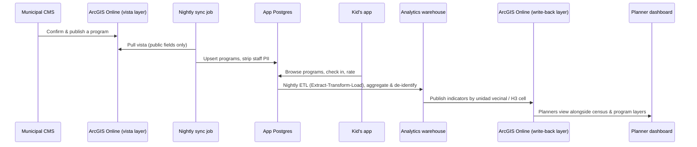
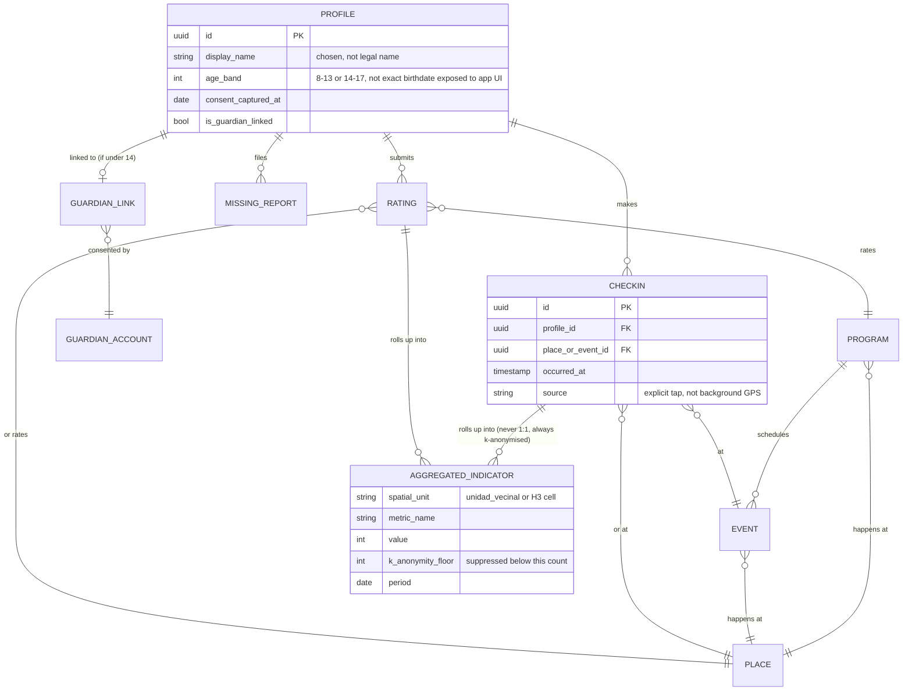
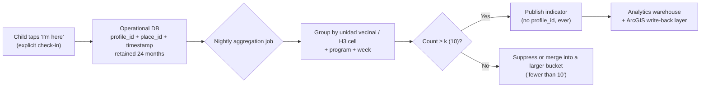
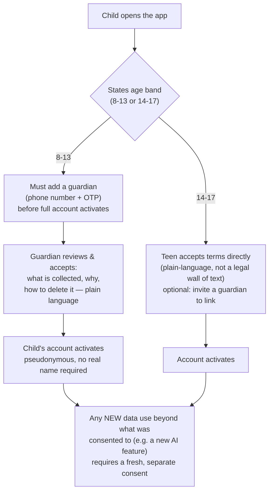

# Platform Architecture — Kids App Lo Espejo

*Prepared for: the design team, Municipality of Lo Espejo, and CIT‑UAI. Written as a teaching document — every technical term is defined the first time it appears. Date: 2026‑09‑28.*

---

## 0. How to read this document

This is the "engine room" document. If `03_design` describes what a child, a parent or a planner *sees*, this document describes what makes that screen possible, safely, at the scale of a whole comuna (a Chilean municipality — the smallest unit of local government), and without turning children's movements into a surveillance record.

It answers one question: **what internal system keeps the app stable as users grow, and moves data safely from a kid's phone to a planner's dashboard?**

Five things shaped every decision below, given to me as established facts about this project:

1. There is already a working geographic data system: CIT‑UAI's ArcGIS Online organization (**ArcGIS Online** — Esri's cloud GIS platform; a **feature service** is a live, queryable layer of map data served over the web) hosts the public visor *"OPORTUNIDADES NNA COMUNIDAD"* and the feature services listed in `data/raw/*.schema.json`. We build **with** this system, not instead of it.
2. The programs layer stores personal data of municipal officials (name, email, phone of each program's *encargado*, i.e. program manager).
3. One public layer, `Beneficiarios_programas`, has a schema built to hold minors' personal data and is currently empty of real records — a live risk, not yet a live breach.
4. The target cohort is roughly 11,200 children aged 8–17 in Lo Espejo.
5. Most users are on Android, prepaid mobile data, and older or budget phones — so "low bandwidth, offline‑tolerant" is a design constraint, not a nice‑to‑have.

I verified every legal claim in §5 against the official text on `bcn.cl/leychile` (Chile's Biblioteca del Congreso Nacional, the government body that publishes the authoritative version of every law) or, where the live BCN viewer could not be rendered by my tools, against the Diario Oficial publication and at least two independent legal‑analysis sources that quote the same article numbers. Dates and figures for commercial products (§2.5, §3.4) are vendor list prices as published in September 2026 and will drift — treat them as order‑of‑magnitude, not quotes.

---

## 1. Architecture overview

### 1.1 The pieces, in plain language

| Piece | What it does | Analogy |
|---|---|---|
| **Client app** | What a kid, parent or program manager taps on their phone | The dashboard of a car |
| **API** (Application Programming Interface — the contract that lets the app ask the server for data without knowing how the server stores it) | The only door between the app and the data | A restaurant counter: you order, you never walk into the kitchen |
| **Database** | Where current, operational data lives (accounts, check‑ins, ratings) | The kitchen's fridge — fast access, not built for archiving |
| **Auth** (authentication — proving who you are; **authorization** — what you're allowed to do once you're proven) | Issues and checks the "who are you, what can you do" tokens | The wristband at a venue |
| **CMS** (Content Management System — a non‑engineer‑friendly editor for structured content) | Where municipal staff edit programs, places, events without touching code | A blog's editing screen |
| **Analytics warehouse** (a second database, tuned for asking big historical questions instead of running the app) | Where check‑ins and ratings become the indicators planners read | The archive room, separate from the fridge |
| **Dashboards** | What a planner at the municipality or CIT‑UAI actually looks at | The car's fuel gauge, not the engine |
| **ArcGIS Online** | The existing map layers of programs, census blocks, schools, parks | A shared reference library the app reads from and, later, contributes back to |

### 1.2 System diagram



### 1.3 Why a Progressive Web App (PWA), not a native app

A **PWA** is a website built to behave like an app: it can be "installed" to a home screen, works partly offline via a **service worker** (a small script that caches pages and data so the app still opens with no signal), and sends notifications — without going through an app store.

| Option | Fit for Lo Espejo | Verdict |
|---|---|---|
| **Native (Kotlin/Swift, two codebases)** | Best raw performance, but doubles engineering cost and every update needs a Google Play review cycle. Overkill for a municipal program with a small team. | Rejected for v1 |
| **Flutter / React Native (one codebase, compiled to native)** | Good performance, single codebase, but still ships through Play Store, still needs a native build pipeline, heavier install (20–40 MB) for prepaid‑data, budget‑Android users. | Reasonable v2 option once usage is proven |
| **PWA (React or Svelte + service worker)** | Near‑zero install friction (tap "Add to Home Screen," no Play Store account or storage needed), trivially updated (ship to a URL, everyone gets it), tiny initial payload possible (<500 KB), works after a bad-signal train ride because of offline caching, check‑ins queue locally and sync when back online. Android's Chrome supports PWAs fully; this audience is "mostly Android" per the brief. | **Recommended for v1** |

The trade‑off: a PWA has weaker access to phone hardware (e.g., no background GPS — which, in §5.3, is a privacy *feature*, not a limitation, for this app) and push notifications are less reliable on iOS. Given the cohort is mostly Android and background location is something we want to avoid anyway, this trade‑off favors the PWA.

### 1.4 Recommended concrete stack

| Layer | Recommendation | Why |
|---|---|---|
| Client | **React + Vite**, packaged as a PWA (Workbox for the service worker) | Huge hiring pool, mature offline tooling, small bundle possible |
| API | **Node.js (TypeScript) on a small managed platform**, or Supabase's auto‑generated REST/GraphQL layer over Postgres | TypeScript end‑to‑end (same language client and server) lowers the bar for a small team; Supabase's generated API removes an entire layer of boilerplate |
| Database | **PostgreSQL with the PostGIS extension** (PostGIS adds geographic types and functions — "is this point inside this polygon," "how far apart are these two points" — directly to SQL) | Same technology ArcGIS itself is often built on; lets us do spatial aggregation (§4, §5.3) in the database instead of shipping raw coordinates to a script |
| Backend‑as‑a‑service | **Supabase** (hosted Postgres + auth + storage + auto API + edge functions) *or* self‑hosted Postgres on a regional VPS if data‑residency rules require it | Supabase is open‑source (Postgres underneath, so no lock‑in if we later self‑host), has a São Paulo (`sa-east-1`) region, and a free/low tier suited to a pilot |
| Auth | Phone‑number + OTP (one‑time password sent by SMS), **no email required** for kids; a separate, stronger flow (email + password or SSO) for municipal staff | Many children don't have a personal email; phones are near‑universal even on prepaid plans |
| File/object storage | Supabase Storage or S3‑compatible bucket, region‑pinned | Photos attached to a rating or a "missing bike lane" report |
| Analytics warehouse | Start as materialized views inside the same Postgres (cheapest, simplest); graduate to **DuckDB or a small ClickHouse instance** only once check‑in volume makes ad‑hoc planner queries slow | Don't add a second database technology before you need it — a teaching point as much as an engineering one |
| CMS | A thin custom admin screen (Retool, or a hand‑rolled React admin) over the same Postgres tables that mirror ArcGIS, **not** direct editing of the ArcGIS feature layer by non‑GIS staff | Keeps the ArcGIS layer as the authoritative long‑term geographic record while giving municipal staff a simpler day‑to‑day tool |
| Dashboards | **Metabase** (open source, self‑hostable, reads Postgres directly) for the app's own metrics; **ArcGIS Dashboards** for anything planners already view spatially, fed by the write‑back layer in §1.6 | Reuses skills CIT‑UAI planners already have in ArcGIS; Metabase avoids paying for a BI tool license |
| Hosting | A cloud region **inside Latin America** (Supabase/AWS `sa-east-1`, São Paulo; Chile has no hyperscaler region as of 2026) | Materially lower latency than US/EU regions for Chilean users; also relevant to the data‑residency spirit of Ley 21.719 even though Chile does not yet mandate in‑country storage for this data category |
| Monitoring | **Sentry** (errors), **UptimeRobot or a platform's built‑in health checks** (uptime), Postgres's own slow‑query log | Free/cheap tiers cover a pilot's scale entirely |

### 1.5 ArcGIS Online integration — both directions

This is the one integration this project cannot skip, because CIT‑UAI's planning work already lives there.

**Direction 1 — Read (programs and context layers into the app).**
A nightly job (or on‑demand button in the CMS) calls the ArcGIS REST API — the same public, credential‑free endpoint the existing `tools/extract_arcgis.py` script already uses — against `Programas_Lo_Espejo_NNA_vista` (108 records). It is essential to read from the **vista** (view) layer, not the 269‑record editable layer, and to explicitly select only the fields the app needs (`PROGRAMA`, `DESC_P_RES`, `CATEGORÍA`, `DIREC_ESP`, `HORARIO`, `CUPOS`…), *dropping* `ENC_NOMBRE`, `ENC_CORREO`, `ENC_TELEFO` at ingestion. I checked the live data: **107 of the 108 confirmed program records currently publish the program manager's real email address, and 100 of 108 publish a personal phone number**, through the public feature service. That is a genuinely live exposure of municipal staff's personal data today (not a future risk like `Beneficiarios_programas` — see §5.5), and the app must simply never surface those three fields to end users, regardless of what the source layer exposes. Places (schools, sports facilities, clinics, kindergartens) sync the same way from the `EL_SAUCE_Shape_contexto` layers.

**Direction 2 — Write‑back (app‑generated indicators into ArcGIS Online).**
Once the app is producing check‑ins and ratings, a scheduled job aggregates them (see §5.3 for how, and why never at the individual level) and publishes the results as a **new** feature layer, e.g. `Indicadores_Uso_Espacio_NNA`, keyed by `unidad_vecinal` (the 15 neighborhood units in `UV_LO_ESPEJO`) or by census block group. This lets CIT‑UAI add "how kids actually use this program/park, self‑reported" as a layer inside the same *OPORTUNIDADES NNA COMUNIDAD* visor planners already open — the app becomes a new *sensor* for a system that already exists, rather than a parallel one nobody looks at.



### 1.6 Content management: who updates programs

The 21 distinct program managers behind the 269 records today (I counted them directly in `data/raw/programas_nna_edicion.geojson`) already do the underlying work of keeping this data current; the CMS should sit as close as possible to their existing workflow rather than inventing a new one:

1. A municipal staff member (Dirección de Desarrollo Comunitario, per the sample records) edits a program in the **CMS**, which writes to the same Postgres table the app reads — this table is *also* the record we sync into ArcGIS.
2. A second role, **Data Steward** (§6.2), confirms it — mirroring the existing `SITUACIÓN = CONFIRMADO` workflow already used in ArcGIS (108 of 269 records are currently confirmed; 160 are still `SIN CONFIRMAR`, i.e. draft).
3. Only confirmed programs sync outward, both to the app and to the ArcGIS vista layer.

This means the municipality keeps a *single* source of truth for "what programs exist," instead of the app silently drifting from what ArcGIS says, or double data entry burning out an already‑stretched team.

---

## 2. Sizing

**Sizing** means estimating, ahead of time, roughly how many people will use a system and how much data and computing power that implies — so the team doesn't discover it's too small (or needlessly expensive) after launch.

### 2.1 The cohort, worked from the census data

Two Censo 2024 (Chile's national census) age bins are already extracted into `data/raw/manzanas_uv.schema.json` at block level (fields `n_edad_6_1` and `n_edad_14_`), aggregated for Lo Espejo: **8,767 children aged 6–13**, and **4,622 adolescents aged 14–17**.

The app's scope is 8–17, not 6–17, so the 6–13 bin needs adjusting. Assuming children are roughly evenly spread across the eight single‑year ages 6–13 (a standard simplifying assumption when only banded data is available — the demographics research stage should replace this with the actual single‑year distribution if INE, Chile's national statistics institute, publishes it for the comuna):

```
8,767 ÷ 8 ages  ≈ 1,096 children per single-year age
6–7 year-olds  ≈ 1,096 × 2 ≈ 2,192  (out of scope)
8–13 in scope  ≈ 8,767 − 2,192 ≈ 6,575
+ 14–17        =              4,622
────────────────────────────────────
Cohort 8–17    ≈             11,197  ≈ 11,200
```

This matches the ~11,200 figure already used as the planning target for this project — the calculation above is included so the design team can see *how* a population number turns into a sizing number, not just trust it.

### 2.2 Adoption scenarios

| Scenario | Adoption | Kids using the app | Under‑14 (≈58.7% of cohort, needs linked guardian) | 14–17 (≈41.3%, self‑registers) |
|---|---|---|---|---|
| Conservative pilot | 20% | ~2,240 | ~1,315 | ~925 |
| Realistic mid‑term | 40% | ~4,480 | ~2,630 | ~1,850 |
| Optimistic, comuna‑wide | 60% | ~6,720 | ~3,945 | ~2,775 |

**Parent/guardian accounts.** Ley 21.719 requires verifiable parental or guardian consent to process a child under 14's data (§5.1); the design should assume roughly **one linked guardian account per under‑14 user** as a ceiling for sizing (siblings may share one guardian account in practice, which only reduces the number below this ceiling). At the mid‑term scenario, that is **~2,630 additional guardian accounts**.

**Staff/program‑manager accounts.** Today's data shows 21 distinct program managers across 13 organizations running 269 programs. Allowing for turnover and for the municipality's own planning and communications staff, budget **30–50 CMS/staff accounts** at pilot scale, growing modestly as more organizations onboard.

**Peak events.** A summer‑program launch or a concert announcement is a *spike*, not steady load: plan for **10–20× the daily‑active baseline within a 2‑hour window** (e.g. everyone checking a schedule at 6 p.m. the night before). This governs the *API request‑rate* sizing below far more than the *total account* sizing does.

### 2.3 Load and storage, mid‑term scenario (4,480 kids + 2,630 guardians + ~1,850 self‑registered teens + 40 staff ≈ 7,150 total accounts)

| Metric | Estimate | Basis |
|---|---|---|
| Daily active users (DAU) | ~1,100–1,800 (25–40% of registered) | Typical DAU/MAU (Monthly Active Users) ratio for a utility‑style civic app, not a game |
| Average requests per session | ~15–25 (browse programs, view map, check in, rate) | Typical for a lightweight content + map app |
| Peak requests/second, normal day | <5 req/s | (1,800 DAU × 20 req) ÷ (12 active hours × 3,600 s) ≈ 0.8 req/s average, ×5 for peak‑hour concentration |
| Peak requests/second, event spike | 30–60 req/s for a 1–2 hour window | 10–20× normal peak, per §2.2 |
| Rows added per year (check‑ins + ratings) | ~1.5–3 million | 1,800 DAU × ~2 events/day × 300 active days, generously |
| Operational DB size after year 1 | **2–6 GB** | Postgres rows are small (a check‑in is a handful of columns); photos go to object storage, not the DB |
| Object storage (rating photos etc.) | **5–20 GB/year** | Assuming a minority of ratings include a compressed photo |
| Analytics warehouse after year 1 | **<1 GB** (it stores *aggregates*, by design — see §5.3) | This is the point of aggregating instead of keeping a raw event log forever |

**Read this table's real message:** a comuna of 11,200 kids, even at 60% adoption with a viral concert night, is *small* by modern database standards — this is a low‑hundreds‑of‑dollars‑a‑month problem, not a "we need Kubernetes and a data engineering team" problem. The engineering discipline this project needs is mostly in §5 (privacy) and §6 (governance), not in raw scale.

### 2.4 What actually drives cost and design effort here

Not user count — **device and network conditions**. Prepaid data plans in Chile are typically metered in the hundreds of megabytes to a few gigabytes a month; a bloated web app can burn a meaningful fraction of a family's monthly data allowance in a few sessions. This is why §1.3's PWA choice, aggressive caching, and image compression matter more to this project's success than server sizing does.

### 2.5 Cost ranges per year (list prices, accessed September 2026 — verify before budgeting)

| Item | Pilot (2–3 unidades vecinales) | Comuna‑wide (60% adoption) | Source / date |
|---|---|---|---|
| Supabase (managed Postgres + auth + storage + API) | Free tier or **Pro at US$25/month** (~US$300/yr); includes 8 GB DB, 100 GB storage, 50,000 monthly active auth users | Pro plan likely still covers it (7,150 accounts is far under the 50,000 MAU included); budget **US$25–60/month** (~US$300–720/yr) allowing for compute‑credit overage | Supabase pricing page, accessed Sept 2026 |
| ArcGIS Online credits (write‑back layer storage/hosting; reading the existing public REST endpoints is free) | **500 credits/year already included** in most standard ArcGIS Online user‑type licenses (Creator/Professional); a new small aggregated layer is unlikely to exceed this | If usage grows, additional credits are ~**US$120 per 1,000 credits** (~US$0.12/credit) | Esri ArcGIS Online credits store page, accessed Sept 2026 |
| Error monitoring (Sentry) | Free tier | Free–US$26/month team tier if volume grows | Vendor pricing page, accessed Sept 2026 |
| BI dashboard (Metabase) | Free (self‑hosted, open source) | Free, plus the cost of the small VM it runs on (~US$5–10/month) | Metabase is open source |
| Small VM for Metabase / background jobs (if not folded into Supabase Edge Functions) | ~US$5–10/month | ~US$10–20/month | Typical regional VPS pricing |
| SMS OTP for phone‑based login | ~US$0.01–0.05 per SMS (Twilio/local aggregator, Chile rates) | At 7,150 accounts with occasional re‑logins, likely **US$50–200/yr** | Twilio Chile SMS pricing, accessed Sept 2026 |
| **Rough total** | **~US$400–700/year** | **~US$800–1,500/year** | — |

This excludes people time (§6.3), which will dwarf infrastructure cost — as is normal and healthy for a project this size: the money should go to the humans doing content, moderation and community work, not to servers.

---

## 3. Data model

### 3.1 Entities

- **Program** — a municipal or partner‑organization offering (a workshop, a sports school, a health check‑up program). Mirrors ArcGIS's `Programas_Lo_Espejo_NNA` schema; the app's copy carries only public‑safe fields (§1.5).
- **Place** — a physical location: a park, a sports court, a school, a health center, a bike lane segment. Sourced from `EL_SAUCE_Shape_contexto` layers and, for parks/public space, potentially new data the municipality collects.
- **Event** — a specific, dated occurrence (this Saturday's session of a recurring program; a one‑off concert).
- **Profile** — an app account. A kid's profile is **pseudonymous by default** (§5.2): a display name the child chooses, no real name required for under‑14s beyond what parental consent capture needs internally.
- **Guardian link** — connects a Profile under 14 to a consenting adult's account (§5.1). This is a *relationship*, deliberately modeled as its own table rather than a field on Profile, so it can be revoked without deleting the child's account.
- **Check‑in** — an explicit, user‑initiated record that "I am/was at this Place or Event." The single most important record type in the whole system, because it is the raw material for every urban indicator — and the single most sensitive, because it is a location‑and‑time fact about a specific child (see §5.3 for how it is protected).
- **Rating** — a kid's feedback on a Program, Event or Place (stars, tags like "too far," "too crowded," optional short text, optional photo).
- **Missing‑thing report** — a lightweight "there should be a skate park here" / "no bus stop nearby" submission — the qualitative counterpart to quantitative check‑ins.
- **Aggregated indicator** — never about one child; a rolled‑up count/rate per unidad vecinal, per H3 cell (§5.3), or per program, published to the analytics warehouse and, selectively, back to ArcGIS.

### 3.2 Entity‑relationship diagram



### 3.3 Event taxonomy — turning taps into urban indicators

An **event taxonomy** is the fixed vocabulary of "things that happen in the app" that everything downstream (analytics, dashboards) is built on. Naming these deliberately, in advance, is what prevents a warehouse full of inconsistent, unusable logs two years in.

| Event name | Key properties captured | Urban/program indicator it feeds |
|---|---|---|
| `program_viewed` | program_id, category, age_band of viewer | Demand signal per category, before commitment — "interest not yet served" |
| `checkin_created` | place_or_event_id, occurred_at, age_band, unidad_vecinal (derived from Place, not from the child's own location) | Actual attendance/usage per program, per place, per time of day/week |
| `rating_submitted` | target_id (program/place), stars, tags[], has_photo (bool, not the photo itself in the event record) | Satisfaction and specific friction ("too far," "unsafe," "full") per program/place |
| `missing_report_filed` | category (e.g. "sports," "bike lane," "lighting"), unidad_vecinal, free‑text (moderated, §6.4) | Unmet‑need signal for capital planning — what doesn't exist yet |
| `route_viewed` *(optional, later)* | origin unidad_vecinal, destination place — **never precise GPS trace**, see §5.3 | Desire‑line signal for bike‑lane/transit planning, without ever storing a path |
| `guardian_consent_recorded` | guardian_account_id, profile_id, timestamp, method | Compliance record for Ley 21.719 (§5.1) — this is an *audit* event, kept separately from behavioral events and never joined into the analytics warehouse |
| `account_created` / `account_deleted` | age_band only, no PII in the analytics copy | Growth and retention indicators; deletions must cascade (§5.4) |

Every row in the *operational* database keeps the individual `profile_id`; every row that reaches the *analytics warehouse* has already been aggregated and stripped of it (§5.3) — this boundary is the single most important line in the whole architecture.

---

## 4. Privacy of minors — the section that matters most

Everything above is standard web‑application engineering. This section is specific to building for children, in Chile, in 2026, and it should be read by everyone on the team, not just engineers.

### 4.1 The Chilean legal framework, verified

**Ley 19.628, sobre Protección de la Vida Privada** (Chile's original data‑protection law, in force since 1999) is, as of today (2026‑09‑28), still the operative personal‑data law in Chile. It is a comparatively thin framework by current international standards and does not have specific rules for children's data or a dedicated enforcement agency.

**Ley 21.719** was published in the *Diario Oficial* on **13 December 2024**. It substantially rewrites Ley 19.628's framework for personal data protection and creates a new independent public agency, the **Agencia de Protección de Datos Personales (APDP)**, with powers to supervise, investigate, sanction (fines of up to 20,000 UTM — *Unidad Tributaria Mensual*, a monthly tax unit Chile uses to index fines, worth several million pesos — or 4% of income for repeat offenders) and issue binding general rules. Per its own transitional provisions (*artículo primero transitorio*), it **enters into force on 1 December 2026** — 24 months after publication. **That is roughly two months from today.** Practically: this project is being designed in the last weeks of the *old* regime and must launch already compliant with the *new* one, because the new law's higher bar for children's data is what will be enforced for essentially its entire operating life. Building only to Ley 19.628's lower bar would be obsolete before pilot.

Ley 21.719's Article 16 quáter (added into the amended Ley 19.628) specifically addresses **datos personales relativos a niños, niñas y adolescentes** (personal data of children and adolescents): processing such data must attend to their *interés superior* (best interests — a standard drawn from the UN Convention on the Rights of the Child) and their *autonomía progresiva* (progressive autonomy: the recognition that a child's capacity to decide for themselves grows with age, so a 16‑year‑old is treated differently from a 6‑year‑old even though both are minors). The law defines **niño/niña** as under 14 and **adolescente** as 14 to under 18. For a **niño/niña under 14**, consent to process their personal data must come from a parent, legal guardian, or whoever holds their *cuidado personal* (legal custody) — the child cannot validly consent alone, the processing must serve their best interest, and (per the same body of secondary legal analysis I cross‑checked against BCN's own published law‑digest for this statute) it may not be used for commercial or advertising purposes directed at the child. For **adolescents 14–17**, ordinary consent rules that apply to adults generally extend to them for standard processing, but sensitive data categories still carry extra protection.

**Ley 21.430, sobre Garantías y Protección Integral de los Derechos de la Niñez y Adolescencia** (published **15 March 2022**) is Chile's children's‑rights framework law, implementing the Convention on the Rights of the Child domestically. Three articles are directly relevant here: **Artículo 26** (right to identity), **Artículo 33** (right to privacy and to protection of personal data), and **Artículo 34** (right to honor, private life and one's own image). This law is the reason "an app that captures how kids use the city" is a governance‑sensitive product even before Ley 21.719 is counted: the right to privacy of a child is a *constitutional‑adjacent, rights‑based* claim in Chilean law, not merely a data‑protection compliance checkbox.

**Practical rule for this project, combining both laws:** treat 14 as the hard line for "requires verifiable guardian consent before any account exists," and treat *every* age band's data with the "best interest + progressive autonomy" lens of Article 16 quáter — e.g., a 16‑year‑old can reasonably consent to seeing which programs they attended reflected back to them, but should still never be shown to have "attended" anything to a party outside the platform without a clear, separate action on their part.

### 4.2 International references (brief, for comparison — not binding on this Chilean project, but good practice)

- **UK ICO Age Appropriate Design Code** (the "Children's Code," in force since September 2021, UK Information Commissioner's Office): 15 standards for any online service "likely to be accessed by children." Two are directly load‑bearing for this project's design: **data minimisation** (collect only what's needed for the specific feature a child actively chose to use, with separate opt‑ins per feature rather than one blanket consent) and **geolocation off by default** — location‑sharing must default to *off*, need a compelling, child‑best‑interest justification to default to *on*, and must show an obvious, persistent indicator to the child whenever it is active.
- **UNICEF, Policy Guidance on AI for Children, version 2.0** (November 2021, developed with the Government of Finland): nine requirements for child‑centred design of data‑ and AI‑driven systems, including supporting children's development and well‑being, protecting children's data and privacy, and ensuring transparency, explainability and accountability to children and their guardians. Relevant here even though this app is not primarily an AI product, because any future feature that *recommends* programs to a child based on their check‑in history counts as exactly the kind of profiling this guidance addresses.
- **COPPA** (US Children's Online Privacy Protection Act; the FTC's implementing rule took effect **April 2000**, was amended effective **July 2013**, and was amended again with a final rule **finalized in January 2025**): requires verifiable parental consent before collecting personal information from a child under 13, and increasingly restricts using children's data for targeted advertising. Not legally binding in Chile, but its "verifiable parental consent" mechanism is a useful, well‑tested design pattern (§4.6).
- **GDPR Article 8 ("GDPR‑K")** (EU General Data Protection Regulation, applicable since 25 May 2018): sets a default digital‑consent age of 16 for "information society services" offered directly to a child, but lets member states lower it to as low as 13 — in practice EU countries range from 13 to 16. Chile's 14‑year threshold in Ley 21.719 sits inside that same European range, which is a useful sentence to have ready for any partner or funder asking "is Chile's standard reasonable?"

### 4.3 Location data of minors — its own section, because it is the highest‑risk data type in this app

A **check‑in is fundamentally a (child, place, time) triple** — the same shape of information a court order for cell‑tower records asks for. Get this wrong and the app becomes a surveillance tool wearing a civic‑engagement costume; get it right and it becomes one of the more privacy‑respectful youth data products in Chile.

**Precise vs. coarse location.** The app should never need to know a child's exact GPS coordinate. It needs to know *which Place or Event* they engaged with — a value chosen from a finite list the municipality already curates (§1.5), not a continuous `(lat, lon)` pair. **On‑device processing**: if a "find programs near me" feature uses the phone's GPS at all, that coordinate should be used to sort/filter a list on the device and then discarded — it should never be sent to or stored on the server. The server should only ever receive "user checked in at Place #482," never "user was at 33.5321°S, 70.6801°W at 14:32:07."

**Check‑ins as explicit acts, never background tracking.** The child taps "I'm here" (or, for a program with a known schedule, confirms attendance after the fact). **Background location tracking — the app periodically recording where the phone is, without an explicit action each time — is not recommended, full stop.** It offers marginal data quality gain over explicit check‑ins for this project's actual goal (understanding program/place usage, not movement patterns) while carrying disproportionate privacy risk, a much harder consent story under Article 16 quáter's "best interest" test, and real battery/data cost on the low‑end Android phones this audience uses (§0). If a future version genuinely needs richer usage data, prefer *more frequent, still‑explicit* check‑in prompts over passive tracking.

**Aggregation before anything leaves the operational database.**
- **k‑anonymity**: a privacy technique where a published statistic is only shown if it represents *at least k* distinct individuals — e.g., "12 kids checked into this program on Tuesday" is fine at k=10, but "2 kids checked into this program" would identify near‑enough to specific children in a small neighborhood and must be suppressed or bucketed ("fewer than 10"). **Recommend k=10** as the floor for any indicator broken down by a small category (a specific program, a specific day) and re‑evaluate upward if a category is small (e.g., a niche program with only 15 total participants all year).
- **Spatial generalization**: never publish an indicator at a resolution finer than the **unidad vecinal** (15 units already defined in `UV_LO_ESPEJO`) for anything derived from individual children's behavior, or, where a finer grain is genuinely needed for planning, an **H3 cell** (H3 is Uber's open‑source system for dividing the map into a grid of hexagons at chosen sizes — resolution 8, about 0.46 km² per hexagon, is a reasonable comuna‑planning grain) — and apply the same k‑anonymity floor to whichever unit is used.
- **Retention periods**: individual‑level check‑in and rating rows should have a defined lifespan in the operational database — **recommend 24 months**, after which raw rows are deleted and only the already‑aggregated indicators survive (aggregates, having no individual‑level content, are not personal data and can be retained indefinitely for the municipality's historical planning record). This mirrors the "don't keep what you don't need" spirit of both Chilean laws and the ICO Code's data‑minimisation standard.



### 4.4 Consent flow, by age band



### 4.5 Data minimisation checklist (what the app should *not* collect, ever)

- Full legal name of a child (a chosen display name is enough for the product to function).
- Home address (Place/Program addresses are enough; "near me" uses on‑device location per §4.3).
- Exact birthdate where an age band (8–13 / 14–17) suffices for every actual feature.
- RUT / número de documento (Chile's national ID number) — the app has no legitimate feature that needs it; note that `Beneficiarios_programas` (§4.6) collects exactly this for children, which is precisely why it is the biggest single governance risk in the whole data landscape this project touches.
- Any continuous location trace (§4.3).
- Any field whose only purpose is "might be useful for something later" — if a feature isn't shipping now, its data shouldn't be collected now.

### 4.6 Governance risk, addressed explicitly: `Beneficiarios_programas`

The existing public ArcGIS feature service `Beneficiarios_programas` has a schema (`data/raw/beneficiarios.schema.json`) built to hold, per child: `Nombres`, `Apellidos`, `Edad`, `Fecha_de_nacimiento`, `Género`, `Dirección`, `Programa`, `Número_de_documento` (RUT) and `Nacionalidad`. It currently holds **one empty record** — nothing is exposed today. But the schema itself is the risk: it is designed to be filled with exactly the combination of fields (full name + birthdate + address + national ID) that constitutes the most sensitive possible dataset about a child, sitting on a **public** ArcGIS layer.

**Recommendation, in order of preference:**

1. **Do not fill this layer.** Whatever administrative process currently intends to use it (tracking which children are enrolled in which program, for internal municipal reporting) should be redesigned to store that data, if it must exist at all, in a system with authentication, access control and audit logging — the operational Postgres database in this architecture, behind the CMS's staff‑only auth, is a suitable home, **not** a public GIS feature layer.
2. **If municipal reporting genuinely needs individual‑level beneficiary records** (e.g., for a grant‑funder's compliance requirement), store them in the app's own database with row‑level security restricting access to named, audited municipal roles, and represent them to CIT‑UAI's planning layer only as the same kind of k‑anonymized aggregate described in §4.3 — never as a 1:1 public export.
3. **Change the layer's sharing setting to private/organizational** immediately, regardless of the above, as a zero‑cost, zero‑delay first step, while the longer‑term redesign in (1)/(2) is scoped. This is a five‑minute ArcGIS Online administration change and closes the door on the layer ever being filled while still public.
4. Document, in the municipality's own data‑governance record, *why* this layer exists, who is accountable for it, and a decommissioning date if it turns out nothing actually depends on it — my review of the visor and the layer list found no dashboard or public map currently displaying it, which suggests it may be a leftover from an earlier data‑collection template rather than an active dependency.

A second, smaller, but *currently live* finding from the same review (§1.5): the "public" `Programas_Lo_Espejo_NNA_vista` layer already exposes real personal emails and phone numbers for the program managers behind 107–108 of its records. This is adult staff data, not children's data, so it falls under Ley 19.628 today and Ley 21.719 from December 2026, not under the children‑specific provisions — but it is real, present‑tense personal data on a public endpoint and should be remediated (drop those three fields from the public view, or move them to a field‑level‑restricted layer) on the same timeline as the `Beneficiarios_programas` fix, since both are the same underlying pattern: **a field was added for internal use and never re‑checked before the layer went public.**

---

## 5. Governance and operations

### 5.1 Who owns what

| Domain | Owner | Notes |
|---|---|---|
| Program & place content (what's true about the world) | **Municipality of Lo Espejo** (Dirección de Desarrollo Comunitario and partner units, per the existing `ENC_UNIDAD` data) | They already do this work in ArcGIS; the CMS should reduce their effort, not add a second system to maintain |
| App account data, check‑ins, ratings | **The app operator** (likely the municipality as data controller, with CIT‑UAI or a contracted dev team as *encargado de tratamiento* — data processor, a defined role under Ley 19.628/21.719 for whoever processes data on the controller's behalf under contract) | A written data‑processing agreement between the municipality and any technical operator is not optional once Ley 21.719 is in force |
| Aggregated urban indicators | **CIT‑UAI**, for research and planning use, published into the shared ArcGIS org | This is the "give back to the existing system" half of §1.5 |
| Legal compliance and the relationship with the future APDP (Agencia de Protección de Datos Personales) | **Municipality**, as the ultimate data controller facing Chilean law | Cannot be outsourced away, even if day‑to‑day engineering is contracted out |

### 5.2 Roles needed to run this, not just build it

- **Product/data steward (municipal staff)** — confirms programs, resolves the CMS's moderation queue, is the human the APDP or a worried parent would actually reach. This is a part‑time responsibility layered onto existing communications/participation staff at pilot scale, not necessarily a new hire.
- **Engineer(s)** — 1 full‑stack engineer is enough to build and run the pilot described in §7; a second joins for the comuna‑wide phase, plus part‑time GIS support from CIT‑UAI for the ArcGIS write‑back layer.
- **Moderator** — reviews open‑text fields (ratings' free text, missing‑thing reports) for anything concerning (bullying language, a child disclosing something requiring a welfare referral, spam). At pilot scale this can be the same person as the product/data steward; it should not remain unstaffed, because open text fields written by children are exactly where a well‑meaning feature turns into a safeguarding incident if nobody reads them.
- **CIT‑UAI research contact** — consumes the write‑back layer, sanity‑checks that indicators make sense against known ground truth (e.g., does a program with high self‑reported attendance also have a healthy `CUPOS`/participant ratio in the existing data).

### 5.3 Security baseline

- Every write to a child's data happens over an authenticated, HTTPS‑only API; no ArcGIS **editing** credential is ever embedded in the client app (only the public, read‑only vista endpoint is called from client‑adjacent code, and only server‑side).
- **Row‑level security** (a Postgres/Supabase feature that restricts which rows a given logged‑in user can see or change, enforced by the database itself rather than trusted to application code) on every table containing a `profile_id`.
- Secrets (API keys, database credentials) live in the hosting platform's secret manager, never in client‑side code or a public repository.
- A written incident‑response point of contact (§5.2's data steward) and a basic runbook: what to do first if a leak is suspected, who to notify (including, from December 2026, potentially the APDP itself, depending on its eventual reporting‑obligation regulations).

### 5.4 Deletion and the right to be forgotten

A guardian (for under‑14s) or the teen themself (14–17) can request full account deletion at any time. Deletion must cascade: the Profile, its Check‑ins, Ratings, Guardian‑link and any object‑storage photos are removed from the operational database within a defined SLA (Service Level Agreement — a promised response time; recommend 30 days, matching common regional practice). Already‑published **aggregated** indicators are not retroactively recomputed (they contain no individual‑level trace to remove), but the underlying raw rows that fed them are deleted going forward.

### 5.5 Monitoring and releases

- **Monitoring**: uptime checks on the API and on the nightly ArcGIS sync job specifically (a silent sync failure is much easier to miss than a down website, and directly breaks §1.5/§4.3's "don't publish anything not properly aggregated" guarantee if a bad job accidentally runs unaggregated data through).
- **Releases**: a PWA's biggest advantage here — ship a fix by deploying to the web, everyone gets it on next load, no app‑store review wait. Still worth a lightweight staging environment and a rollback plan before every release touching the consent flow (§4.4) or the aggregation job (§4.3), since mistakes there are privacy incidents, not just bugs.

---

## 6. Phased roadmap

```mermaid
flowchart LR
    subgraph P0["Phase 0 — Foundation (months 1-2)"]
        A1["Finalize consent flow,\nCMS, data model"]
        A2["Fix Beneficiarios_programas\nand vista PII exposure (§4.6)"]
    end
    subgraph P1["Phase 1 — Pilot, 2-3 unidades vecinales (months 3-6)"]
        B1["Launch PWA to ~1,500-2,500\nkids in the pilot UVs"]
        B2["First aggregated indicators\nwritten back to ArcGIS"]
    end
    subgraph P2["Phase 2 — Comuna-wide (months 7-12)"]
        C1["Open to all 15 unidades\nvecinales"]
        C2["Second engineer, moderation\ncadence formalized"]
    end
    subgraph P3["Phase 3 — Sustained operation (year 2+)"]
        D1["Ley 21.719 fully in force,\nfirst annual data-governance review"]
        D2["Planner dashboards inform\nnext capital investment cycle"]
    end
    P0 --> P1 --> P2 --> P3
```



| Phase | KPI (Key Performance Indicator — a specific, measurable target) |
|---|---|
| Phase 0 | `Beneficiarios_programas` set to private or redesigned (binary, done/not done); consent flow tested with real guardians in usability sessions, not just engineers |
| Phase 1 (pilot) | ≥20% of the 8–17 cohort in the pilot UVs registered; ≥1 aggregated indicator layer live in the CIT‑UAI visor; zero unaggregated personal data ever reaches the warehouse (audited monthly) |
| Phase 2 (comuna‑wide) | ≥40% comuna‑wide adoption; moderation queue median response time <48 hours; at least one municipal planning decision documented as informed by an app‑derived indicator |
| Phase 3 (sustained) | Annual data‑governance review completed and published; retention policy (§4.3) enforced automatically, not manually; guardian‑deletion requests fulfilled within SLA 100% of the time |

---

## 7. Glossary

- **API (Application Programming Interface)** — the defined set of requests a client app is allowed to make to a server, and the answers it can expect back.
- **Auth (authentication / authorization)** — proving who you are (authentication), and then determining what you're allowed to do (authorization).
- **CMS (Content Management System)** — a non‑technical editing interface for structured content (here: programs, places, events).
- **Feature service / feature layer** — ArcGIS Online's term for a live, queryable layer of map data with attribute fields, served over the web.
- **H3** — Uber's open‑source hexagonal grid system for dividing a map into cells of a chosen size, used here to aggregate location data above the individual level.
- **k‑anonymity** — a privacy guarantee that a published data point represents at least *k* distinct individuals, so no one can be re‑identified from it.
- **OTP (One‑Time Password)** — a short code sent by SMS or similar, used to prove control of a phone number without a traditional password.
- **PII (Personally Identifiable Information)** — any data that can identify a specific person, alone or combined with other data.
- **PostGIS** — an extension to PostgreSQL adding geographic data types and spatial functions.
- **PWA (Progressive Web App)** — a website engineered to behave like an installed app, including offline support via a service worker.
- **Row‑level security** — a database feature restricting which rows a given user can see or modify, enforced by the database itself.
- **Service worker** — a background script a PWA uses to cache content and enable offline use.
- **Unidad vecinal (UV)** — a neighborhood‑level administrative subdivision of a Chilean comuna; Lo Espejo has 15.
- **UTM (Unidad Tributaria Mensual)** — a monthly tax unit Chile uses to index fines and some payments to inflation.

---

## 8. References (APA 7)

Agencia Nacional de Inteligencia (n.d.). *Ley 21719: Regula la protección y el tratamiento de los datos personales y crea la Agencia de Protección de Datos Personales*. Biblioteca del Congreso Nacional de Chile. https://www.bcn.cl/leychile/navegar?idNorma=1209272

Biblioteca del Congreso Nacional de Chile. (n.d.). *Ley 21430: Sobre garantías y protección integral de los derechos de la niñez y adolescencia*. https://www.bcn.cl/leychile/navegar?idNorma=1173643

Esri. (2026). *ArcGIS Online credits — pricing*. Retrieved September 2026, from https://www.esri.com/en-us/arcgis/products/credits/buy

Federal Trade Commission. (2025, January). *FTC finalizes changes to the Children's Online Privacy Protection Rule* [Press release]. https://www.ftc.gov/news-events/news/press-releases/2025/01/ftc-finalizes-changes-childrens-privacy-rule-limiting-companies-ability-monetize-kids-data

Information Commissioner's Office. (2021). *Age appropriate design: A code of practice for online services*. https://ico.org.uk/for-organisations/uk-gdpr-guidance-and-resources/childrens-information/childrens-code-guidance-and-resources/age-appropriate-design-a-code-of-practice-for-online-services/

Regulation (EU) 2016/679 of the European Parliament and of the Council of 27 April 2016 (General Data Protection Regulation), art. 8. https://gdpr-text.com/read/article-8/

Supabase. (2026). *Pricing*. Retrieved September 2026, from https://supabase.com/pricing

UNICEF Office of Global Insight and Policy. (2021, November). *Policy guidance on AI for children, version 2.0*. https://www.unicef.org/innocenti/media/1341/file/UNICEF-Global-Insight-policy-guidance-AI-children-2.0-2021.pdf

*Notes on sourcing:* the live BCN "navegar" viewer for Leyes 21.719 and 21.430 could not be rendered by this session's fetch tooling (it returned a client‑side loading error rather than the document), so the article numbers and dates above were cross‑verified against the Diario Oficial publication record and at least two independent legal‑analysis sources quoting the same figures for each claim; the design team should still pull the BCN PDF directly before any legal filing that depends on exact article text.

---

## Handoff: constraints for design

What the UI **must ask**:
- The child's **age band** (8–13 or 14–17) at first launch — this single answer routes everything else (guardian flow or not, which features are visible).
- For 8–13: a **guardian's phone number**, and the guardian's own explicit, plain‑language acceptance of what is collected and why, before the child's account fully activates (Ley 21.719, Art. 16 quáter; §4.1, §4.4).
- Explicit, per‑action confirmation before a check‑in is recorded ("I'm here" — a deliberate tap, never inferred).
- Explicit, separate permission before turning on any device‑location feature (e.g. "find programs near me"), defaulting to **off** (UK ICO Children's Code standard; §4.2, §4.3).

What the UI must **never ask**:
- Full legal name (a chosen display name is enough).
- Home address, exact birthdate, RUT/national ID number, or any field matching the `Beneficiarios_programas` schema (§4.6) — the app has no feature that needs these, and asking for them recreates the exact governance risk this document flags.
- Anything that implies continuous or background location tracking is happening (because it must not be happening at all; §4.3).

What the UI **must show**, always visible or one tap away:
- A plain‑language explanation, written for a child, of what happens to a check‑in or rating after it's submitted (it becomes part of an anonymous count the municipality uses to improve programs and parks — not "the municipality sees you were here").
- A visible, persistent indicator any time location access is active, per the ICO standard (§4.2) — never silent.
- A simple, discoverable path to **delete my account and my data**, for both the guardian's view and the teen's own view, with a clear statement of what "deleted" actually means (§5.4).
- For guardians specifically: what their linked child's account can and cannot do, and how to revoke the link.
