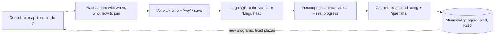

# Reflejo: UX strategy and design system

*Role: `ux-ui-designer`. Inputs: the handoff sections of `01_research/01-04` and
`02_platform/platform_architecture.md`. Tags like **[P3]** point to a psychology paper,
**[B7]** to a benchmark pattern (row 7 of the pattern library), **[D]** to demographics,
**[L]** to the platform/legal constraints and **[V]** to the visor analysis.*

---

## 0. The idea in one line

**Reflejo** is the map of Lo Espejo where kids find something to do near them, go, check in
at the real place, and tell the city what's missing. The city learns from the reflection.

The name comes from the comuna (*espejo* is mirror, *reflejo* is reflection) and says what
the data loop does: kids see their barrio in the app, and the municipality sees how kids live
the barrio. It also means *reflex*, a sporty, quick word teens don't find childish.

## 1. Design principles

| # | Principle | Because |
|---|---|---|
| 1 | **The map is home.** Every activity, place and event is a pin on one map of Lo Espejo. The list is a companion, not a second app. | Pokémon GO and Harrastuspassi **[B1, B9]** |
| 2 | **Value before asks.** The first screen shows three real things near you before asking age, barrio or consent. | Headspace **[B14]**; 38% onboarding drop-off |
| 3 | **Progress is only real when you're really there.** Stickers, visits and rewards come from checking in at the place (QR at the venue or an explicit "Llegué" tap), never from time in the app. | Althoff et al. 2016 **[P3]**; SDT competence **[P1]**; measure visits, not minutes **[S1]** |
| 4 | **Two ages, one app.** 8-12 get Chinco the mascot, missions and an album; 13-17 get a night theme, direct copy and small known-friend visibility. | Adolescent peer-reward sensitivity starts in mid-adolescence **[P4, S4, S5]** |
| 5 | **Meaning over points.** No global points, no leaderboards. Rewards are local and real: a sticker for each place, priority sign-up, free entry to municipal events. | Gamification: points and leaderboards are the weakest lever **[P2]** |
| 6 | **Calm by design.** No fake timers, no "only 2 left!" unless true, no guilt, no infinite feed, notifications only for real news near you. | Radesky et al. 2022 **[P5]**; Duolingo backlash **[B7]** |
| 7 | **Safe and legible data.** Ask the minimum, say in kid language what happens to each tap, and make delete-my-data one tap away. | Ley 21.719 art. 16 quáter; ICO Children's Code **[L]** |

## 2. People

**Matías, 10 (8-12 mode).** Lives in UV 24, where 1,182 kids share two activity sites and
none for his age **[V]**. Uses his mom's Android on prepaid data **[D]**. Loves futsal and
drawing. Can't cross Av. Central alone, so "near" means 5-10 minutes walking. He needs
pictures, big buttons and one clear thing to do.

**Javiera, 15 (13-17 mode).** Studies at Liceo Polivalente, has her own phone with a small
data plan, plays in the school batucada and wants to join a band. Finds "kid stuff"
embarrassing. Goes out with friends, not alone, and avoids some streets after dark. She
needs to know when, where and who else is going, fast.

**Daniela, 38 (guardian).** Matías' mom. Works shifts. She approves the account from her own
phone with a code, wants to know it's free, safe and that nobody can contact her son.

**Paula, planner at the Oficina Local de la Niñez.** Uses the CIT-UAI visor. Wants to know
which programs kids actually attend, from which UV, and what's missing where.

## 3. Core loop

The loop closes in the real world: CITY → D is the promise that makes kids' feedback matter.
The app shows it ("Gracias a 214 reportes, la Plaza Buenaventura tendrá luces nuevas") so
kids see their reflection change the barrio.

## 4. Screens and flows

**Onboarding (≤ 60 s, no typing for 8-12):**
1. **Hola** — the real map with the three closest things lit up, and a single "¡Vamos!" button.
2. **Edad** — number chips 8...17 (one tap). Routes consent and mode **[L]**.
3. **Barrio** — "¿Dónde pasas más tiempo?": pick your school or tap your barrio on the map.
   No GPS required, no address **[L]**.
4. **Gustos** — pick up to 3 interests (icons + words).
5. **Adulto (only under 14)** — "Pídele a un adulto que te acompañe": guardian enters their
   phone, gets an SMS code and a plain-language summary. Until approved, the kid can browse
   but can't check in or rate **[L, Ley 21.719 art. 16 quáter]**.

**Main navigation (bottom bar, 4 items, icon + label):** Mapa · Agenda · Álbum · Yo.
**Ayuda** is a persistent heart button in the top bar, always one tap away.

| Screen | Purpose | Key elements |
|---|---|---|
| Mapa (home) | Discover | Map of Lo Espejo, category chips (Hoy, Deporte, Música y arte, Aprender, Aire libre), card carousel "Cerca de ti", mascot tip (8-12) |
| Ficha (bottom sheet) | Plan | Name, category, age range badge, "Gratis", when, where + walk minutes, how to join, organizer unit, "Voy" + "Guardar" + "Compartir con un amigo" [B8] |
| Llegué (check-in) | Prove presence | QR scan simulation at the venue, or explicit "Llegué" tap within 150 m; success = sticker reveal |
| Cuenta (rating) | Give back | 3 faces (8-12) or 5 (13-17), "¿Qué falta?" chips (sombra, luz, baños, agua, juegos para mi edad, basureros, me sentí seguro/a), optional 140-char note for 14-17 (moderated) |
| Agenda | Events | This week's events and class times by day |
| Álbum | Progress | Stickers of places visited (58 plazas, 58 canchas...), real rewards and how close you are |
| Yo | Profile + data | Display name, mode, interests, **Tus datos** (what we save, what the municipality sees, delete) |
| Ayuda | Support | Oficina Local de la Niñez, Oficina de Juventud, CESFAM/CESAM, emergency lines. Calm palette, no gamification |
| Municipio (demo only) | Show the data loop | Choropleth of kids vs offer by UV, check-ins by place, top "qué falta" tags, all aggregated |

**Empty and error states.** No activities for your age nearby → show the closest ones, say
it honestly ("En tu barrio aún no hay talleres para tu edad. Cuéntanos qué te gustaría")
and turn it into a wish (city data). Offline → cached map and saved activities still work.

## 5. Visual system

**Concept: *muralismo*.** Chilean community muralism (the brigadas muralistas tradition,
strong in the poblaciones of the south of Santiago) gives the language: flat saturated
fills, thick dark outlines, hard shadows, suns, stars, hands and birds. It belongs to Lo
Espejo, reads well on cheap screens, and feels like street art to teens rather than a toy.

### Color tokens

| Token | Day (8-12 default) | Night (13-17 default) | Use | Contrast |
|---|---|---|---|---|
| `--bg` | `#FFF5E6` wall cream | `#15142A` night | Page | — |
| `--surface` | `#FFFFFF` | `#23213F` | Cards, sheets | — |
| `--ink` | `#1D1B33` | `#FFF5E6` | Text, outlines | 15.5:1 / 16.7:1 |
| `--ink-soft` | `#4A4766` | `#C9C4E8` | Secondary text | 8.2:1 on cream |
| `--sol` | `#FFC23D` | `#FFD23F` | Primary action (ink text) | ink on it 10.4:1 |
| `--rojo` | `#E0442E` | `#FF6A4D` | Live / "Hoy" / alerts (large text only) | ink on it 4.0:1 (large) |
| `--cat-deporte` | `#2DBE72` | same | Sport | ink on it 6.9:1 |
| `--cat-arte` | `#FF6FA3` | same | Music, dance, art | 6.4:1 |
| `--cat-aprender` | `#6FA0FF` | same | Learning, robotics | 6.5:1 |
| `--cat-aire` | `#9BD65A` | same | Parks, playgrounds, bike lanes | 9.7:1 |
| `--cat-evento` | `#FF8A3D` | same | Events | 7.1:1 |
| `--cat-ayuda` | `#B9A6FF` | same | Help (calm) | 7.9:1 |

Rule: category colors are **fills** with ink icons and labels on top; they never carry text
as the text color. Color is never the only signal: every category also has an icon and a word.

### Type

- **Display:** Bricolage Grotesque 700-800 (Google Fonts). Quirky, contemporary, reads as
  "street poster" to teens, friendly to kids.
- **Body and UI:** Atkinson Hyperlegible 400/700. Designed by the Braille Institute for
  low-vision legibility; distinct letterforms (I/l/1, 0/O) help early readers **[D]**.
- **Scale (px):** 13 caption · 15 body-s · 17 body · 20 title-s · 24 title · 32 display ·
  44 hero. Minimum body 16px in 8-12 mode.

### Shape, space, elevation

- Outline `2.5px solid var(--ink)` on interactive elements, stickers and cards (the mural line).
- Radius: 12 (chips) · 18 (buttons) · 24 (cards, sheets) · 999 (pills, pins).
- Elevation is a **hard offset shadow**, `0 4px 0 var(--ink)`, never blur. Pressing a button
  moves it down 3px and removes the shadow: the tap *feels* physical.
- Spacing on a 4px grid: 4, 8, 12, 16, 24, 32. Screen gutters 16px.
- Touch targets ≥ 48x48px; primary buttons 56px tall in 8-12 mode.

### Iconography and illustration

- Custom line icons, 24px grid, 2.2px ink stroke with round caps, inside category-colored
  circles when used as pins.
- Stickers (album): circular cut-outs with a white 4px border and the ink outline, the place
  name curved on the rim, a small flat illustration (sun, tree, ball, note).
- Mascot **Chinco**, a *chincol* (the small crested sparrow of every Santiago plaza): curious,
  local, not a cartoon animal from somewhere else. Only in 8-12 mode, only to guide and
  celebrate, never to guilt **[P5]**.

### Map

- Base: CARTO Voyager tiles warmed with a CSS filter in day mode, CARTO Dark Matter in night
  mode. Streets matter: kids and guardians navigate by street names from the program data.
- Overlays: barrio (UV) outlines as thin dashed ink lines; parks as soft green dots; bike
  lanes as a thick dashed green line; pins as round stickers (category fill + ink outline +
  icon + hard shadow). Selected pin grows 1.25x and bounces once.
- Offline fallback: if tiles or the map library fail, the same pins render on a drawn SVG of
  the 15 barrios, so the app still works.

## 6. Motion

| Token | Value | Use |
|---|---|---|
| `--t-fast` | 120ms | Press, toggle |
| `--t-med` | 240ms | Sheet, chip, screen change |
| `--t-slow` | 480ms | Celebration, sticker reveal |
| `--ease-out` | `cubic-bezier(.2,.8,.2,1)` | Most movement |
| `--ease-spring` | `cubic-bezier(.34,1.56,.64,1)` | Pins, stickers, the playful bits |

What moves and why:
- **Pins drop in** with a 30ms stagger on first load: tells you the map is alive and where things are.
- **Bottom sheet** slides up with the spring; the map stays visible behind (context kept).
- **Buttons** press down (tactile feedback).
- **Check-in**: the sticker peels in (rotate -12° → 0°, scale 0.4 → 1) with a short burst of
  mural shapes, plus a 20ms vibration where supported. This is the one "big" moment; it
  marks a real-world achievement **[P1]**.
- **Chinco** blinks and bobs gently; never interrupts.
- `prefers-reduced-motion: reduce` → no drops, no bursts, instant sheets; the sticker simply appears.

## 7. Forms for kids

- No typing in 8-12 onboarding: chips, icons, map taps.
- School search: type 2+ letters, results appear as big rows.
- Guardian phone: numeric keypad, `+56 9` prefilled, 8 digits, inline validation in words
  ("Faltan 2 números").
- Errors say what to do, next to the field, in ink on a light red background, with an icon.
- Never a CAPTCHA, never a password for kids (the guardian's SMS code links the device).

## 8. Voice (Chilean Spanish)

| Moment | 8-12 (Chinco talks) | 13-17 (the app talks) |
|---|---|---|
| Welcome | "¡Hola! Soy Chinco. Mira todo lo que hay cerca de ti." | "Lo que pasa en Lo Espejo, cerca tuyo." |
| Empty | "Aquí todavía no hay talleres para tu edad. ¿Qué te gustaría que hubiera?" | "Nada para tu edad por acá todavía. Dinos qué falta." |
| Check-in | "¡Llegaste! Ganaste el sticker de la Plaza Buenaventura." | "Check-in listo. +1 en la Plaza Buenaventura." |
| Data | "Lo que cuentas se suma con lo de otros niños. Nadie sabe que fuiste tú." | "Tus datos se suman de forma anónima. Nadie ve tu nombre ni por dónde andas." |
| Reminder | "Mañana hay batucada en tu cole a las 13:30." | "Batucada mañana 13:30, Colegio Hernán Olguín." |

Rules: *tú*, short sentences, no irony with 8-12, no "¡Wow!" overload, no slang that dates
fast. Gender-inclusive through wording ("niñas y niños", "seguro/a" in chips).

## 9. Acceptance criteria for the prototype

1. Opens on the real map of Lo Espejo with real pins from the CIT-UAI and OSM data, and a
   "Cerca de ti" carousel, before any question.
2. Onboarding: age chips → mode + consent route; barrio or school choice; interests; guardian
   step for under 14.
3. Category filters work on map and list; ages filter what's shown.
4. Activity sheet with when, where, walk minutes, age, free, how to join, organizer unit
   (never a person's name), "Voy", "Guardar", "Compartir".
5. Check-in via simulated QR + explicit tap, with the sticker animation.
6. 10-second rating with "¿Qué falta?" chips; confirmation says how the data is used.
7. Álbum with real places as stickers and real rewards.
8. Ayuda with OLN, Juventud, CESFAM/CESAM; no gamification there.
9. Yo → "Tus datos": what's saved, what the municipality sees, delete.
10. Day (8-12) and Night (13-17) modes switch tone, mascot and theme.
11. Municipio view: kids vs offer by UV (Censo 2024 + visor), with demo usage data labeled demo.
12. Desktop: phone frame + presenter panel with demo controls. Mobile: full screen.
13. Tokens in `:root`; AA contrast; targets ≥ 48px; reduced motion; no console errors;
    works at 360px wide.

---

## 10. What the loop changed in this spec

The prototype loop (`05_loop/iteration_log.md`) found places where this spec was wrong or
incomplete. The build is the reference; these are the decisions it now encodes.

| Area | Was | Now | Why (iteration) |
|---|---|---|---|
| Main action on a place | "Llegué · hacer check-in" | **"Quiero ir"**; check-in is secondary ("¿Ya llegaste? Gana el sticker") | You plan from home and check in at the place (critic, it. 3) |
| Check-in without a QR sign | A tap was enough | One location check, explained first; declining gives a "Visita anotada" that doesn't count toward rewards | Completion must require being there (critic, it. 3) |
| "Cómo llegar" | Link to Google Maps | Walking line drawn on our own map, with minutes and "La línea es recta: sigue las calles" | A third party shouldn't learn where a child is going (it. 4-5) |
| 13-17 progress | Same sticker album | **"Tus lugares"**: a place grid and a clean place card; 1-5 rating; CV certificate reward | Cartoon stickers read as childish to a 15-year-old (critic, it. 3) |
| 13-17 identity | Chinco everywhere | Wordmark only; initials avatar | Same |
| Friends (13-17) | "2 personas de tu grupo van" | Groups added in person by QR; "Mi grupo ve a dónde voy" **off** by default | Opt-in for location-like info (critic, it. 3) |
| Guardian | SMS only | SMS lists everything stored (incl. check-in places, 90-day retention, "BORRAR" to withdraw) + a guardian view: can / can't / what's stored / revoke | Full disclosure; Ley 21.719 art. 16 quáter (it. 4-5) |
| Safety | Not in the UI | "Termina cuando ya está oscuro · Pídele a un adulto que te vaya a buscar" on anything ending after 19:00 | Demographics handoff: region's highest homicide rate (it. 4) |
| Tokens | Targets "≥ 48 px" as a rule | `--tap: 48px` token, `--err-bg`, `--danger`; pin hit areas 48 px | Measured audit found 44 and 32 px targets (critic, it. 3) |
| Type | 12.5-15.5 px sizes in use | Snapped to 13 · 15 · 17 · 20 · 24 · 32 · 44 | Critic, it. 3 |
| Map | Could open on an empty area | Refits when fewer than 3 pins are clear of the bars; labels on the nearest 5 pins, no overlaps | Critic, it. 3; it. 4-5 |
| Feedback | None after check-in outside the overlay | "+1" badge on Álbum / Lugares | It. 5 |
| Offline | Not designed | Banner "Sin internet: el mapa de calles no cargó, pero los lugares sí"; pins keep working; service worker when served | It. 3-5 |
