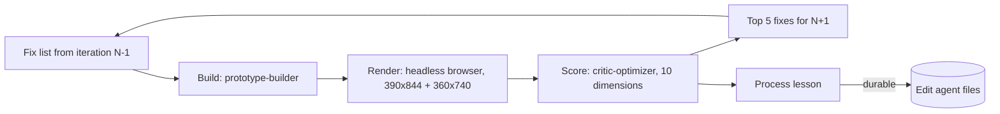

# The optimization loop

Each iteration: **build → render → score → fix list → process lesson**. Minimum 5 iterations.
The builder and the critic are different roles; the critic works from screenshots and the
rubric below, not from the builder's intentions.

## Rubric (0-10 each, 100 total)

| # | Dimension | 10 looks like | Evidence source |
|---|---|---|---|
| 1 | **First 30 seconds** | A 10-year-old sees something real nearby and knows what to tap before being asked anything | Headspace pattern; psych P1 |
| 2 | **Map as the board** | The map of Lo Espejo is home; places are the content; list is a companion | Pokémon GO; Harrastuspassi |
| 3 | **Real-world loop** | Discover → go → check in at the place → see real progress; completion requires being there | Psych P3, P1; Althoff et al. (2016) |
| 4 | **Age-adaptive** | 8-12 and 13-17 see different tone, social features and framing; teens don't find it childish | Psych P4, S4, S5 |
| 5 | **Visual identity and craft** | Distinct, local (Lo Espejo, not a template), consistent tokens, clear hierarchy | Benchmark visual language |
| 6 | **Motion and feedback** | Every action answers; motion explains, never decorates; reduced-motion respected | Design system §6 |
| 7 | **Kid ergonomics and accessibility** | Targets ≥48px, AA contrast, icons + words, low-literacy friendly, 360px wide works | WCAG 2.2; demographics |
| 8 | **Safety and privacy by design** | Age-gated consent, no precise location shared, no public profiles or open chat, data use explained in kid language | Ley 21.719; platform handoff |
| 9 | **City-data loop** | Ratings, "what's missing" and check-ins visibly turn into planner value (aggregated) | Platform handoff; visor §6 |
| 10 | **Robustness** | No console errors, works offline for core screens, fast on a low-end Android | Platform handoff |

**Banned (automatic -3 on the relevant dimension):** fake timers or scarcity, guilt-trip
mascots or notifications, public leaderboards of kids, infinite feeds, dark-pattern consent,
background location tracking.

## Measurement before scoring

Scores for measurable criteria come with a measurement, never from the spec
(learned in iteration 3, when "targets ≥ 48 px" had been scored from this document):

- `tools/shoot.sh N` renders every state and fails loudly if `#app` has scrolled.
- `tools/audit.js` (run by `shoot.sh`) lists visible targets under 48 px and text under 13 px.
- Every screenshot must show the state its filename claims; a mismatched screenshot is a
  robustness bug, not a capture glitch.
- At least twice in the loop (midpoint and final), the critic is a separate agent that scores
  before reading the builder's scores.

## Stop rule

Run at least 5 iterations. After 5, continue only while the total score improves by 3+ points
per iteration and no dimension is below 7.

## Process lessons

The critic writes one lesson per iteration about how the **system** should work differently
(e.g. "the designer should specify empty states"). If the lesson is durable, it's written
into the relevant `.claude/agents/*.md` file and noted in the log as `→ applied to <file>`.
